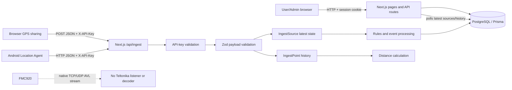
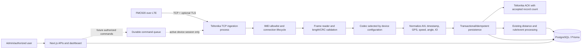

# FMC920 Compatibility Audit

**Audit date:** 2026-10-30  
**Scope:** Read-only review of the existing repository and official Teltonika documentation. No application changes, schema changes, package installation, or device commands were performed.

## 1. Executive Summary

**Overall compatibility: Not ready for direct FMC920 integration.** The platform can accept GPS observations sent as JSON over HTTP by its browser tracker and Android companion app. It has no TCP or UDP listener, no Teltonika AVL/Codec decoder, no IMEI registration or device-authentication flow, and no Codec command sender. An FMC920 configured to send its native Teltonika data stream cannot post that stream directly to the existing REST route.

The existing fleet platform does provide useful foundations: user sessions and roles, user-owned API keys, vehicle/person records, latest-location fields, indexed location history, distance/rule/event processing, and map/history screens. These are not equivalent to a hardware ingest stack. Tracker metadata is currently folded into the vehicle/source row, and “online” means a recent HTTP ingest, not a connected tracker or verified fresh GNSS fix.

The smallest sound direction is to add a persistent Teltonika TCP ingestion process alongside the Next.js web app, initially using the codec selected in the FMC920 configuration. It should authenticate the IMEI against a registered device, decode/validate AVL records, store them through a shared location-processing path, and return the correct acknowledgement only after the accepted records are durably stored. Then associate a registered device with a vehicle and reuse the existing map and history views.

Remote output control is not supported today. Teltonika documents Codec 12 GPRS commands, including digital-output commands, but the command path depends on an active device session and exact firmware/configuration. No physical commands were issued in this audit. DOUT1 must be wired and used only according to the FMC920 wiring and electrical ratings; it is a switching output, not an independent 12 V supply.

**Evidence limitation:** the requested `FMC920 (EN).pdf` was not present in the repository. The hardware-specific review therefore uses Teltonika’s official FMC920 wiki pages and the supplied specifications as context. The exact device codec selection, firmware-specific command behavior, and output electrical limits still need confirmation against the installed device’s firmware/configuration and its matching manual/wiring document.

## 2. Existing Architecture

The project is a Next.js 16 App Router application using React 19 and TypeScript, PostgreSQL 18 through Prisma 6, Zod validation, and Leaflet/react-leaflet for map views. API handlers live in the same Next.js application. The Android Location Agent is a separate Kotlin application using Android’s fused location provider and OkHttp; it posts JSON over HTTP. The database is the shared persistence layer. The only separate recurring worker found is a deadline-job script; it does not ingest tracking data.



The current app-facing flow is:

1. A human signs in through `POST /api/auth/login`; the server validates a bcrypt password and creates a database session represented by an HTTP-only cookie.
2. Browser sharing uses `navigator.geolocation.watchPosition`; the Android app runs a location foreground service and reads fused GPS fixes.
3. Those clients send JSON to `POST /api/ingest` with an `X-API-Key` (or bearer) header.
4. The route validates the key and Zod payload, upserts an `IngestSource` by its unique `name`, creates an `IngestPoint`, updates distance totals, and starts rule/event processing asynchronously.
5. The dashboard and map poll HTTP APIs. The dashboard refreshes about every 10 seconds, the live map about every 5 seconds; there is no WebSocket or broker-based push path.

The source of truth for this description is the implementation, not the top-level README, which still describes an older registration/heartbeat/worker flow that does not match the current route inventory. `CODEBASE_GUIDE.md` is closer to the current implementation.

## 3. Implementation Inventory

| Area | Existing implementation and responsibility |
|---|---|
| Web framework and runtime | `package.json`: Next.js `16.4.0`, React `19.3.0`, TypeScript, App Router routes/pages; `src/app/api/**/route.ts` contains HTTP handlers. No TCP/UDP/MQTT listener dependency or listener entry point was found under `src/`. |
| Database and ORM | `prisma/schema.prisma`: PostgreSQL models and relations; `src/lib/db.ts`: Prisma singleton. |
| Human authentication | `src/app/api/auth/login/route.ts`, `src/app/api/auth/logout/route.ts`, `src/lib/auth-session.ts`, `src/lib/api-helpers.ts`, `src/proxy.ts`: bcrypt login, DB-backed session cookie, `user`/`admin` roles, route guards. Public registration is absent. |
| API-key authentication | `src/lib/api-keys.ts` and `src/app/api/keys/route.ts`: API keys are generated with `gpta_` prefix, SHA-256 hashed in storage, user-owned, and revocable. This is an HTTP client credential, not an FMC920 IMEI/protocol authentication implementation. |
| Location ingest | `src/app/api/ingest/route.ts` and `src/lib/validation.ts`: `POST /api/ingest` accepts JSON fields `name`, latitude/longitude, optional accuracy/speed/sample time/event ID. It does not parse a binary Teltonika packet. |
| Android source | `android-location-agent/app/src/main/java/com/gps/locationagent/service/LocationShareService.kt`: fused location acquisition and periodic OkHttp HTTP requests with `X-API-Key`; this is phone GPS tracking, not a hardware gateway. |
| Vehicle/tracker management | `src/app/api/vehicles/route.ts`, `src/app/api/trackers/route.ts`, corresponding pages under `src/app/app/(fleet)/`: CRUD and tracker metadata. Tracker data is stored on `IngestSource`; it is not a separate device aggregate. |
| Latest source/status API | `src/app/api/ingest/sources/route.ts`: returns latest positions and labels sources `no_fix`, `stale`, or `fresh` based on position and `receivedAt`. `src/app/api/overview/route.ts` computes fleet totals and calls sources “online” if recently received. |
| Location history | `IngestPoint` in `prisma/schema.prisma`; `GET /api/ingest/sources/[name]` reads a capped number of points; history/map pages visualize trails. |
| Processing | `src/lib/distance.ts` calculates Haversine distance and movement deltas; `src/lib/rules/engine.ts` evaluates rules; `src/lib/rules/events.ts` creates rule events, evidence points, notifications, and optional tasks. |
| Dashboard and maps | `src/app/app/(fleet)/page.tsx`, `map/page.tsx`, `history/page.tsx`, and `src/components/tracking-map.tsx`: map and vehicle-centric summaries, polling, location history. No physical device connection or command UI. |
| Background service | `scripts/jobs.ts` and `src/lib/jobs/**`: scheduled deadline checks and job-run logging, not device connectivity, telemetry ingestion, or command delivery. |
| Tests | `scripts/e2e-api.mts` covers HTTP login/API-key/JSON-ingest/overview smoke checks; other scripts cover trash, jobs, and managed locations. No Teltonika packet fixtures or decoder tests were found. |
| Configuration/dependencies | Root package manifest has no MQTT client, Teltonika protocol library, or transport listener package. Repository instructions list `DATABASE_URL`, seed/admin settings, and auth settings; secret values were not inspected or copied into this report. |

## 4. Compatibility Matrix

| Requirement | Current implementation | Status | Evidence | Required action |
|---|---|---|---|---|
| User authentication | DB session, HTTP-only cookie, bcrypt password check, `user`/`admin` roles; no public registration. | PARTIAL | `src/lib/auth-session.ts` (`createSession`, `getAuth`); `src/app/api/auth/login/route.ts`; `src/lib/api-helpers.ts`. | Keep human login separate from device identity. Review inactive-account enforcement: login and `getAuth` do not independently reject `User.isActive === false`. |
| Device authentication | No registered IMEI allowlist or device credential; HTTP API keys belong to users. | MISSING | `src/lib/api-keys.ts` (`validateApiKey`); `src/app/api/ingest/route.ts` (`POST`). | Add device identity/authorization independent of human sessions and API keys. Treat IMEI as an identifier, not a secret. |
| TCP listener | Next.js HTTP route only; no socket server in application source. | MISSING | `src/app/api/ingest/route.ts`; repository search found no `server.listen`/`createServer`/TCP listener under `src/`. | Add a persistent TCP listener for Teltonika binary traffic, with bounded connection and buffer handling. |
| UDP/TLS transport | No UDP listener or Teltonika TLS server. FMC920 configuration has TCP/UDP and optional TLS settings. | MISSING | No transport implementation/dependency in `src/`; official [FMC920 GPRS settings](https://wiki.teltonika-gps.com/view/FMC920_GPRS_settings). | Start with one selected transport (TCP is the simpler initial reliable path); configure and validate TLS before production. Add UDP only if a requirement justifies its separate framing/ACK path. |
| Teltonika protocol decoder | No IMEI handshake or AVL Codec 8/8E/16/12 parser. | MISSING | `src/app/api/ingest/route.ts` accepts JSON only; official [Teltonika AVL Protocols](https://wiki.teltonika-gps.com/view/Codec). | Implement or use a maintained decoder that validates frame length, codec, record counts, IO structure, and CRC; match codec to actual FMC920 configuration. |
| GPS persistence | Latest coordinate plus historical coordinate/speed/accuracy/timestamps are persisted. Hardware heading, altitude, satellite count, and IO are not represented. | PARTIAL | `IngestSource`, `IngestPoint` in `prisma/schema.prisma`; `src/app/api/ingest/route.ts`. | Add a normalized hardware observation contract and preserve required AVL fields/IO without overloading the human-ingest payload. |
| Device management | Trackers are metadata fields on `IngestSource`; no IMEI, firmware, independent authorization/revocation, or communication session. | PARTIAL | `prisma/schema.prisma` (`IngestSource`); `src/app/api/trackers/route.ts`. | Introduce an independently registered device record and explicit lifecycle/authorization fields. |
| Vehicle assignment | Tracker metadata is colocated on the vehicle/source row. Tracker-create accepts `vehicleId` but does not persist/use it. | INCORRECT | `src/app/api/trackers/route.ts` (`trackerCreateSchema`, `POST`); `prisma/schema.prisma` (`IngestSource`, `VehiclePerson`). | Persist an explicit device-to-vehicle assignment with uniqueness and effective dates/assignment history if reassignment is allowed. |
| Device status | “Fresh/online” is derived from recent HTTP ingest timestamps, not a tracker transport session or independent last-GNSS time. Thresholds differ across endpoints. | INCORRECT | `src/app/api/ingest/sources/route.ts`; `src/app/api/overview/route.ts`; `src/lib/config.ts`; `Settings.offlineThresholdS`. | Track last communication and last valid position separately; compute registered/connected/communicating/fix/offline/revoked as distinct states with one configured policy. |
| Admin dashboard | Multi-vehicle map, vehicle names, latest coordinates, speed, movement, and recent rule events exist. It has no IMEI/device connection panel or output commands. | PARTIAL | `src/app/app/(fleet)/page.tsx`; `src/app/api/vehicles/route.ts`; `src/components/tracking-map.tsx`. | Reuse the map; add device identifiers, distinct freshness/connectivity indicators, hardware events, and vehicle/device context. |
| Historical tracking | GPS points are indexed and route trails can be displayed, with a retrieval limit. No explicit point-retention job or hardware raw/IO history. | PARTIAL | `IngestPoint` index in `prisma/schema.prisma`; `src/app/api/ingest/sources/[name]/route.ts`; `src/app/app/(fleet)/history/page.tsx`. | Preserve source timestamp and receive timestamp, define retention/partitioning, and make ordering/deduplication robust for buffered packets. |
| Codec command support | No device socket registry, Codec 12 builder/parser, queue, delivery state, or response processing. | MISSING | No command model/endpoint/listener in schema or source; official [Teltonika AVL Protocols](https://wiki.teltonika-gps.com/view/Codec). | Add an authorized command API, durable command queue, active-session dispatcher, Codec 12 framing, and response/timeout handling. |
| DOUT1 control | No output endpoint/UI or command integration. Teltonika documents GPRS output commands, subject to device/firmware and active-session behavior. | MISSING | No command route/model; official [FMC920 SMS/GPRS commands](https://wiki.teltonika-gps.com/view/FMC920_SMS/GPRS_Commands). | Implement only after protocol, firmware, permissions, wiring, electrical ratings, and operational safety checks are established. |

## 5. Critical Gaps

1. **No native hardware ingress (blocks first FMC920 packet).** The only ingest route is HTTP JSON; the FMC920 sends a Teltonika binary protocol over a configured transport. The Next.js route cannot accept that application protocol as-is. Add a persistent listener and frame-aware reader, then pass decoded records to shared processing logic. A small adjacent process is more appropriate than forcing raw sockets into an HTTP route; it can share the existing database and application modules without requiring a broad microservice redesign.

2. **No protocol handshake, decoder, or server ACK (blocks reliable reception).** Teltonika’s protocol begins with IMEI identification and requires the server to accept/reject the device. AVL TCP records have a length-delimited frame, codec ID, records, duplicate record counts, and CRC; the server must return the accepted-record count. An invalid or missing ACK can cause a resend. Implement stream-safe framing (TCP reads may split or combine frames), CRC/length validation, appropriate acknowledgements, and structured rejection/error logging.

3. **No physical device authorization (blocks safe multi-device operation).** `validateApiKey` maps an HTTP key to a human user. The hardware handshake provides an IMEI, but the repository has no registered-IMEI table. IMEI alone can be spoofed, so it should be allowlisted and bound to an organization/device record; use supported transport security and network controls as additional layers. Do not give the tracker a human login or reuse a browser API key as its identity.

4. **Vehicle/device relationship is not persisted as a relationship (blocks reliable fleet assignment).** Vehicle fields and tracker fields share `IngestSource`; `POST /api/trackers` accepts but ignores `vehicleId`. Hardware records therefore cannot be reliably mapped from IMEI to an intended vehicle. Add an explicit relation and make assignment authorization enforceable.

5. **Current status is not hardware connectivity (blocks meaningful offline reporting).** Source freshness is based on `receivedAt`; overview uses 120 seconds while source freshness uses `STALE_MS` (90 seconds), and `OFFLINE_AFTER_MS` is 75 seconds in a separate legacy presence helper. A recently created tracker with no fix can appear online by timestamp. Model last packet, last valid GNSS fix, active session, and revocation separately, with explicit policy and thresholds.

6. **Hardware AVL fields are discarded (blocks richer telemetry).** `IngestPoint` stores latitude, longitude, speed, accuracy, and timestamps only. The AVL GPS element includes altitude, angle, satellite count, and speed; configurable IO carries input/output, ignition, and device-specific values. Extend persistence using a stable normalized observation plus a versioned/typed IO representation so raw identifiers and values are not lost.

7. **Reliability and idempotence are insufficient for device replay (blocks dependable history).** Current ingest inserts a point for every accepted request and updates the latest source regardless of whether `sampledAt` is older. The optional `eventId` is stored on the source (one current value), not on every point as a durable record key. There is no packet-level duplicate or out-of-order policy. Device buffered records can arrive later; dedupe and latest-position updates must be independent, so historical points are preserved without regressing the current position.

8. **Writes are not atomic across the location pipeline (blocks correct ACK semantics).** Source upsert, history insert, and distance update are separate operations. A listener should not acknowledge records as accepted until the chosen durable persistence boundary succeeds. Use a transaction or an explicitly retryable/idempotent ingestion boundary before counting records in the protocol ACK.

9. **Multi-tenant authorization needs explicit review (security risk before customer rollout).** The schema has `ownerUserId`, but `/api/vehicles` and `/api/trackers` list queries do not filter by owner; vehicle detail GET/PATCH also relies on login without an owner check. This may be intentional in a single shared organization, but it does not implement organization isolation. Further, `/api/ingest` upserts by globally unique name and assigns the authenticated key owner's ID in the update, so a different user's valid key can take over a source if it submits the same name. Define tenant boundaries and enforce them before onboarding multiple organizations.

10. **Remote-control delivery is absent (blocks DOUT1, not initial GPS reception).** There is no live-session registry, durable command queue, Codec 12 support, delivery/response state, retry/timeout, or audit trail. The command should only be enabled after device identity and vehicle authorization are reliable.

11. **Testing lacks hardware protocol coverage (blocks confidence before hardware connection).** Existing scripts test HTTP-level operations, not malformed binary frames, codec variations, TCP fragmentation, IMEI rejection, retries, or device command responses. Build protocol simulator/fixture tests before connecting a physical unit.

## 6. Database Compatibility

### Current schema

```text
User 1---* ApiKey
User 1---* IngestSource (optional ownerUserId)
IngestSource 1---* IngestPoint
IngestSource 1---* Event / Task
Person *---* IngestSource (VehiclePerson)
Settings: singleton-like row keyed by orgKey="default"
```

`IngestSource` serves several responsibilities at once: vehicle data, source identity/name, tracker metadata, current position, distance accumulators, owner, and soft-delete state. `trackerSerial`, `trackerBrand`, `trackerType`, `simCardNumber`, and `trackerSource` are descriptive fields, not a physical-device registry. `trackerSerial` is not protected by a database unique constraint; IMEI is absent. `VehiclePerson` is a person-to-vehicle join, not a device assignment. No `Organization`, `GpsDevice`, connection/session, device-event, or command model exists.

`IngestPoint` is a useful historical foundation. It has `(sourceId, sampledAt)` indexing and stores latitude/longitude, speed, accuracy, sampled time, and receive time. It does not represent altitude, heading, satellites/quality, ignition, DIN/DOUT/AIN, arbitrary AVL IO values, device identity, protocol packet ID, or per-record dedupe identity. `eventId` is on `IngestSource`, not an observation.

### Conceptual direction (not a migration)

```text
Organization
  |-- User / membership and role
  |-- Vehicle
  |     |-- DeviceAssignment (effective dates/status)
  |     +-- GpsPosition history
  |-- GpsDevice (IMEI unique, model, authorized/revoked, firmware metadata)
  |     |-- DeviceConnection/session (connectedAt, disconnectedAt, lastPacketAt)
  |     |-- DeviceEvent / parsed AVL IO
  |     +-- DeviceCommand (queued, sent, acknowledged, failed, expired)
  +-- AuditLog
```

The existing `IngestSource` and `IngestPoint` may be retained and migrated incrementally, or separated into vehicle/source and device/position entities once requirements are settled. The minimum reliable change is an independently registered `GpsDevice` with unique IMEI and organization/vehicle association, plus a location record that preserves source/receive timestamps and hardware fields. Add indexes on device identity, organization/vehicle assignments, latest observation time, and `(deviceId, sampledAt)`; define data retention and any raw-packet retention explicitly. Do not create tables just to mirror a reference diagram if an existing model can be evolved cleanly.

## 7. Communication Architecture

The following is a **proposed** architecture, not current functionality. Start with one transport and a small network-ingestion process running alongside the Next.js application. TCP is a pragmatic first choice because the official device configuration supports it and its per-record ACK is straightforward. TLS can be enabled once certificate generation, device configuration, and server termination are designed and tested. UDP is a separate option with its own wrapper and acknowledgement requirements, not merely a TCP setting change.



The flow must distinguish connection state from data freshness. On TCP connect, parse the IMEI handshake, reject unknown/revoked devices, and attach the connection to the registered device. Read bytes incrementally and decode complete frames only. For each AVL frame, validate bounds, codec, record counts, and CRC before normalizing records. Preserve device event time and server receive time. Commit accepted observations idempotently; only then ACK the count actually committed. On disconnect, mark the session ended and retain the last-packet and last-fix timestamps. On reconnect, authenticate again and allow the device’s buffered records to be processed without replacing newer latest-position state.

Outgoing commands must use the same live device connection/session manager when available. They should be persisted before dispatch, authorized against organization/device/vehicle, and transition through explicit queued, sent, acknowledged, rejected/failed, timed-out, and expired states. If no session is available, retain or expire the command according to policy; do not make a REST request to the tracker’s IP or assume a TCP connection is permanent.

## 8. Remote Command Readiness

**Current readiness: not possible through the platform.** There is no command endpoint, command model, socket session registry, frame encoder, response parser, acknowledgement tracking, timeout/retry behavior, or output UI.

Teltonika’s official [Codec page](https://wiki.teltonika-gps.com/view/Codec#Codec_12) describes Codec 12 (`0x0C`) as the GPRS command protocol. It defines a command frame with type `0x05` and a device response frame with type `0x06`, length fields, command/response bytes, record quantity, and CRC-16/IBM. Teltonika’s [FMC920 SMS/GPRS command list](https://wiki.teltonika-gps.com/view/FMC920_SMS/GPRS_Commands) states GPRS commands require Codec 12 and lists a `setdigout` command with output state and optional timeout/speed parameters. The exact command arguments and availability must be checked against the actual FMC920 firmware and configuration. Codec 12 delivery occurs on an active GPRS session; the Teltonika documentation describes data transfer/ACK before sending commands and recommends keeping the data link active for command delivery. Thus a command may be queued until the device next connects unless its configured session behavior keeps the connection open.

A future API such as `POST /api/devices/{deviceId}/outputs/1` is reasonable as a platform abstraction. It should validate the requested state, ensure the user is authorized for the organization/device/vehicle, require an enabled/safe output policy, create an auditable command row, and return a command ID/status rather than claiming the hardware already changed. A dispatcher maps the abstract request to the exact documented command string, wraps it in Codec 12, sends it only over a valid session, and correlates device response/timeout. Retries must be bounded and account for commands that may have executed even if the response was lost; duplicate toggles are unsafe, so prefer explicit desired state over “toggle.”

**Verified capability vs. assumptions:** Official documentation verifies Codec 12 as the GPRS command mechanism and lists a digital-output command. This repository implements neither. Availability on a particular tracker, output number/command syntax, firmware requirements, active-session timing, acknowledgement semantics, and electrical ratings must be confirmed for the actual unit before enabling the feature. This audit sent no command. DOUT1 is a switching output requiring an appropriate external circuit and must not be treated as an independent 12 V source; verify load wiring and ratings in the exact FMC920 wiring/manual documents.

## 9. Reusable Components

| Existing component | Reuse decision | Rationale |
|---|---|---|
| `src/lib/db.ts` and Prisma/PostgreSQL setup | Reuse with schema evolution | Existing connection and ORM can persist devices and observations; the HTTP-only API surface is not the blocker. |
| `IngestPoint` history and history API/page | Reuse with modifications | Existing coordinate trails and indexed history are useful; add device identity, richer AVL fields, dedupe, and robust ordering/retention. |
| `src/lib/distance.ts` | Reuse with modification | Haversine and gap/movement logic can operate on normalized hardware positions. Ensure out-of-order records do not update the current distance baseline. |
| `src/lib/rules/engine.ts` and `src/lib/rules/events.ts` | Reuse after normalization | Business rules can consume a normalized vehicle snapshot; extend rule fields/events only as requirements demand. Keep binary protocol concerns out of the rule engine. |
| `src/components/tracking-map.tsx` | Reuse | Map markers, routes, geofences, and overlays can display hardware-derived vehicle positions once APIs expose the proper device/vehicle state. |
| Dashboard and history pages | Reuse with modifications | Existing map, vehicle summary, and trail workflows are a good base; add tracker identifier, valid-fix time, last communication, and events/IO. |
| Human session/auth and `logAudit` | Reuse for people; extend for commands | Admin/user sessions and audit logs should govern human command requests. They must not be used as device identity. |
| `src/app/api/ingest/route.ts` JSON contract | Preserve for browser/Android | Maintain as a separate phone/app adapter. A Teltonika listener should normalize into common processing logic rather than pretending binary AVL is this JSON endpoint. |
| Android Location Agent | Preserve as secondary source | It already obtains phone GPS in a foreground service and sends API-key-authenticated HTTP JSON. It should remain an app source, not a proxy for physical trackers. |

## 10. Recommended Development Roadmap

Estimates below are rough engineering estimates for one experienced engineer, excluding device installation, SIM/operator setup, production security review, and unknown firmware/device configuration. Actual effort depends on deployment/network access and codec selection.

### Phase 1 — Hardware communication

**Dependencies:** Confirm device firmware and Configurator settings; select TCP or UDP; provision reachable server address/port and SIM/APN; locate the exact manual, datasheet, and wiring guide.  
**Estimate:** 3–6 engineer-days for a TCP-first listener and handshake; more if TLS/UDP or deployment network changes are required.  
**Work:** Configure FMC920 server host/port/transport and selected AVL codec; create the persistent listener; implement IMEI framing and registered-device accept/reject; handle connect/disconnect and bounded buffering.  
**Acceptance:** A simulator can connect, identify an allowlisted IMEI, receive the expected binary accept/reject byte, and reconnect after disconnect; unknown/revoked IDs are rejected. No physical output command is involved.

### Phase 2 — GPS processing

**Dependencies:** Phase 1 framing and device identity; chosen codec validated against the real FMC920 configuration.  
**Estimate:** 5–10 engineer-days including decoder tests and persistence changes.  
**Work:** Decode supported codec records and selected IO IDs; validate CRC, counts, coordinates, timestamp, and size; normalize location and hardware fields; persist idempotently; return correct ACK only for committed records; route normalized observations into distance/rule processing.  
**Acceptance:** Golden fixtures and simulated packets decode to expected fields; malformed frames receive no successful acceptance; duplicates do not create duplicate history; late buffered points do not regress latest position; DB failure does not produce an accepted-record ACK.

### Phase 3 — Platform integration

**Dependencies:** Normalized persistent hardware positions and device registry.  
**Estimate:** 5–10 engineer-days, depending on tenant/ownership changes.  
**Work:** Add device registration, IMEI uniqueness, organization ownership, vehicle assignment, revocation, timestamps/status calculations, and API authorization. Reuse maps and vehicle dashboards; update endpoints to expose device identity and last-fix vs last-packet.  
**Acceptance:** Admin can register/revoke a tracker and assign it to a vehicle; a simulated position appears under the assigned vehicle; non-authorized users cannot see or mutate another tenant’s device or vehicle; stale connection and stale GNSS fix display separately.

### Phase 4 — Historical tracking

**Dependencies:** Device-to-vehicle mapping and normalized position history.  
**Estimate:** 4–8 engineer-days for history policies and dashboard integration; larger if retention volume requires partitioning or rollups.  
**Work:** Add date-range pagination, stable ordering, retention/cleanup policy, late-record handling, and route/trip/stop logic based on timestamps and configured thresholds.  
**Acceptance:** A simulated trip with gaps and out-of-order buffered points produces a stable ordered history; retention is explicit and tested; route, stop, and event calculations have deterministic tests.

### Phase 5 — Remote control

**Dependencies:** Secure device registration, reliable active-session tracking, exact FMC920 command syntax/firmware confirmed, electrical wiring review, and an approved use case.  
**Estimate:** 5–10 engineer-days for a constrained queue and Codec 12 path, plus safety review/integration testing.  
**Work:** Add an authorized command endpoint, durable command lifecycle/audit, Codec 12 encoder/response parser, session-aware dispatch, expiry/timeout policy, and UI controls with explicit desired state. Keep disabled by default until hardware-side safety review passes.  
**Acceptance:** Unit tests verify exact encoded frames/CRC and response parsing; simulated session demonstrates queue, send, response, timeout, retry, and audit behavior; role/tenant restrictions pass; a real-device test plan is approved separately. No production command is sent by automated tests.

## 11. Testing Strategy

Before attaching a physical tracker, build a local simulator and deterministic protocol tests using official Teltonika packet layouts. Do not send commands to a real device as part of the test suite.

- **Protocol decoder tests:** Codec 8 and any codec actually configured on the FMC920; packet length, preamble, CRC-16/IBM, record counts, GPS coordinates/sign, timestamps, speed/angle/altitude/satellites, and IO encodings.
- **Simulated device packets:** TCP handshake plus one/multiple AVL records, fragmented TCP reads, multiple frames in one read, no-fix records, optional IO fields, and persisted-record acknowledgements.
- **Device identification tests:** allowlisted IMEI accepted; unknown, malformed, duplicate-session, disabled, and revoked IMEI rejected or handled by explicit policy. IMEI should not be treated as a password.
- **Invalid packet tests:** short/oversized frames, inconsistent lengths/counts, invalid codec, malformed IO counts, CRC mismatch, out-of-range coordinates, and incomplete TCP frame followed by timeout/disconnect.
- **Duplicate and ordering tests:** replay exact packet/records; resend after lost ACK; deliver old buffered records after newer fixes; preserve history but never roll back current position or distance baseline.
- **Reconnection tests:** socket close, device reconnect, session cleanup, buffered replay, overlapping connections, and application restart. Verify connected status differs from last packet and last valid fix.
- **Persistence tests:** DB transaction failure, partial-write prevention, ACK only after durability, organization/device/vehicle foreign keys, uniqueness, indexes, and retention behavior.
- **Authorization tests:** human login vs device identity separation, tenant-isolated API queries, source/device assignment, revoke behavior, user/admin rights, and command permission/audit enforcement.
- **Dashboard integration tests:** multiple devices/vehicles, correct IMEI-to-vehicle mapping, current position and speed, last fix/last packet labels, stale/offline states, and history route loading.
- **Remote command encoding tests:** Codec 12 `0x0C` framing, command/response types, length, CRC, queue state transitions, lost response, timeout, expiry, retry bounds, and audit record creation. Use a simulator only; never issue real hardware commands in CI.

Current `scripts/e2e-api.mts` is an HTTP smoke test for user login, API keys, JSON ingest, and overview. It does not satisfy the Teltonika protocol test strategy above. No existing test suite was run for this read-only audit.

## 12. Final Verdict

1. **Can the existing platform receive FMC920 GPS data today?** No, not directly. It accepts HTTP JSON, not the FMC920 native Teltonika stream.
2. **Can it decode the required Teltonika protocol?** No decoder or frame parser was found.
3. **Can it authenticate physical devices?** No. It authenticates human-owned HTTP API keys, not registered IMEIs/device identities.
4. **Can it associate a tracker with a vehicle?** Not reliably as a relationship. Tracker metadata is embedded in the same row, and the tracker-create route’s `vehicleId` input is unused.
5. **Can it display multiple physical trackers?** It can display multiple generic location sources/vehicles, but cannot natively register/authenticate or distinguish actual FMC920s by IMEI. So not as physical trackers today.
6. **Can it store historical GPS observations?** Yes for current HTTP sources, with limited fields and a retrieval cap; it is not yet a complete AVL history store.
7. **Can it detect device disconnection?** No. Current status is derived from last HTTP receive time, not an observed hardware session.
8. **Can it send remote commands to the tracker?** No command mechanism exists.
9. **Can it control DOUT1?** No. Codec 12 is an officially documented GPRS command mechanism and Teltonika lists digital-output commands, but this application does not implement it and the exact device configuration/wiring must be verified.
10. **What is the minimum work required to get the first real GPS location on the dashboard?** Configure the FMC920 to a reachable server/port and selected codec; implement a persistent TCP listener with IMEI allowlisting and correct Teltonika framing/ACK; decode and validate the AVL GPS fields; persist them idempotently against a registered device/vehicle; then expose that position through the existing vehicle/source API used by the dashboard map. Add simulator tests before connecting hardware.

**Readiness assessment: Not ready.** The platform has reusable fleet and map foundations, but direct hardware reception, device authentication/association, and protocol handling are all missing. Successful first-location integration would not by itself establish production readiness; tenant isolation, transport security, replay handling, monitoring, retention, and command safety would still need acceptance testing.

### Official References

- [FMC920 product documentation and downloads](https://wiki.teltonika-gps.com/view/FMC920) (official product page; links to the current datasheet and quick manual).
- [FMC920 GPRS settings](https://wiki.teltonika-gps.com/view/FMC920_GPRS_settings) (server host/port, TCP/UDP, optional TLS, server response timeout, buffering/retry, and ACK type).
- [Teltonika Codec / AVL protocols](https://wiki.teltonika-gps.com/view/Codec) (official protocol and packet structures, codecs, IMEI handshake, TCP/UDP ACKs, Codec 12).
- [FMC920 SMS/GPRS commands](https://wiki.teltonika-gps.com/view/FMC920_SMS/GPRS_Commands) (Codec 12 requirement and documented command list including digital-output control).
- [Sending Codec 12 commands using Hercules](https://wiki.teltonika-gps.com/view/Sending_Codec12_commands_using_Hercules) (official command-frame example and encoding explanation; used only as documentation, no tracker was contacted).
